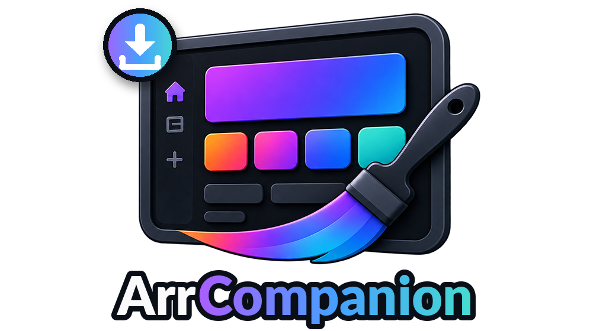

# ArrCompanion

<p align="center"></p>

An Emby plugin that sends the missing titles of [Home Screen Companion](https://github.com/soderlund91/HomeScreenCompanion) to Sonarr and Radarr.

Home Screen Companion (HSC) lists the titles on your External and AI lists that are not in your library. ArrCompanion shows that list, with each title's state in Sonarr or Radarr, and adds the ones you pick:

- **Missing**: movies and shows with their title, year and the HSC lists each one is on (and its place on the list, once HSC sends it).
- **Status**: in Radarr / Sonarr or not, monitored, downloaded, and for a show how many episodes it has.
- **Add**: `+ Radarr` / `+ Sonarr` opens a dialog with root folder and quality profile (Radarr also minimum availability and Monitored). The title is added and searched for. Shows are matched and added by TVDb id (else IMDb id), movies by IMDb id (else TMDb id).
- **Settings**: Sonarr and Radarr URL and API key, with Test Connection. The plugin talks to Sonarr and Radarr itself; a saved API key is only sent to its own saved URL.

It is a separate plugin because Emby's plugin catalog does not take plugins that download. It is not in the catalog.

## Requirements

- Home Screen Companion **4.5 or later**, with **Settings › Show missing titles** on. ArrCompanion reads HSC's list through HSC's own endpoint (`/HomeScreenCompanion/MissingTitles`); it does not change HSC.
- Sonarr and Radarr with API v3.

## Install

**From GitHub** (updates too): with [Emby.GitHubRepoPluginInstall](https://github.com/stoep-labs/Emby.GitHubRepoPluginInstall), add `https://github.com/stoep-labs/ArrCompanion`, install, and restart Emby.

**By hand**: download `ArrCompanion.dll` from the [latest release](https://github.com/stoep-labs/ArrCompanion/releases/latest), copy it into Emby's `plugins` folder and restart Emby.

Then open **ArrCompanion** in the Emby dashboard, enter Sonarr / Radarr under **Settings** and save.

## Build

```
dotnet build ArrCompanion/ArrCompanion.csproj -c Release -p:AppData=<folder with Emby-Server/system/MediaBrowser.*.dll>
```

The CI workflow fetches those reference DLLs from the `mediabrowser.common` and `mediabrowser.server.core` NuGet packages, builds `1.0.0.<run>` and publishes a GitHub release on every push to `main`.

## Credits

Built from [Home Screen Companion](https://github.com/soderlund91/HomeScreenCompanion) by soderlund91 (MIT; his copyright notice is kept in [LICENSE](LICENSE)): the page design, styles and helpers, and the Sonarr / Radarr code of the Stoep fork's Missing tab. Thanks to soderlund for the idea of a separate plugin.

## License

MIT, see [LICENSE](LICENSE).
